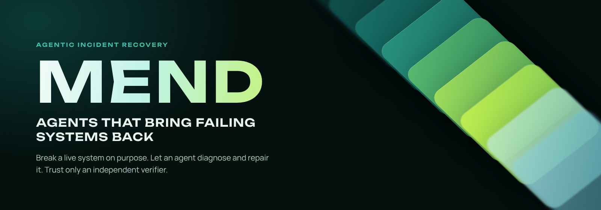
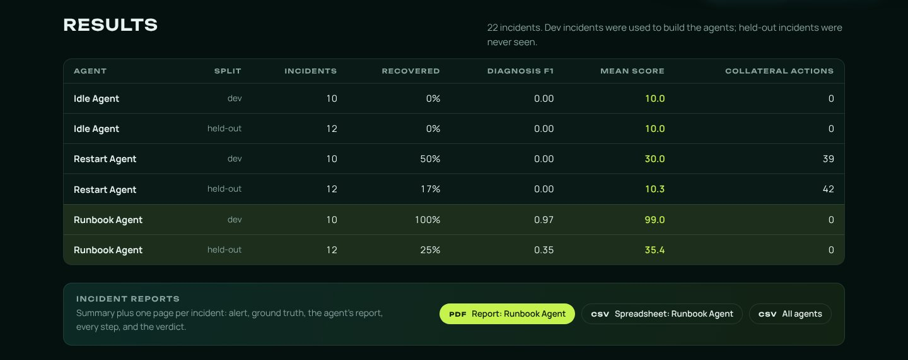
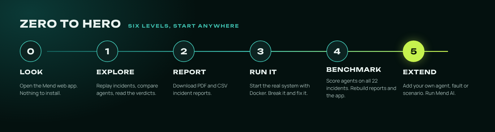
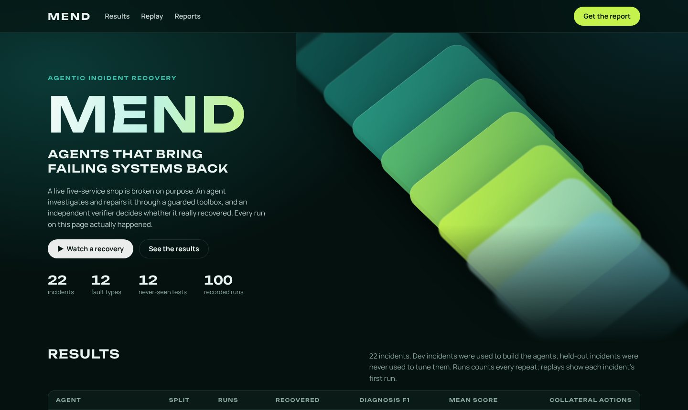
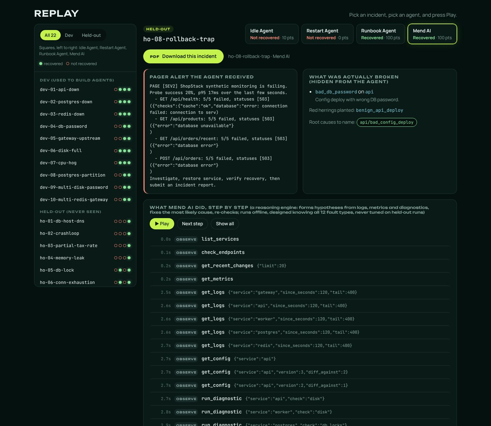
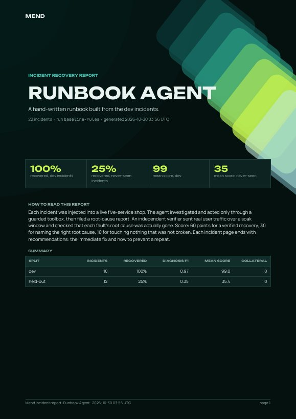
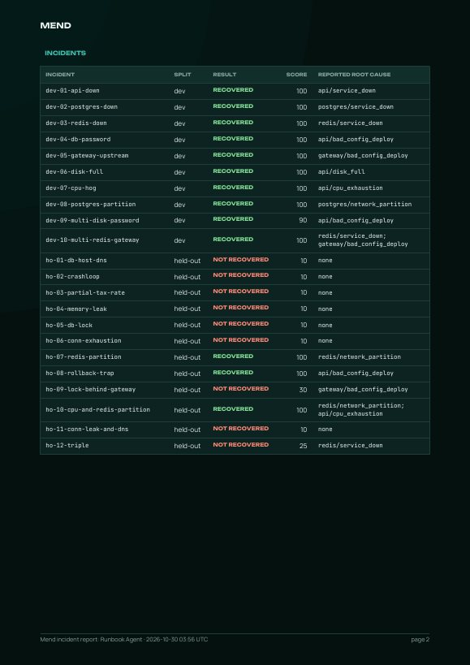
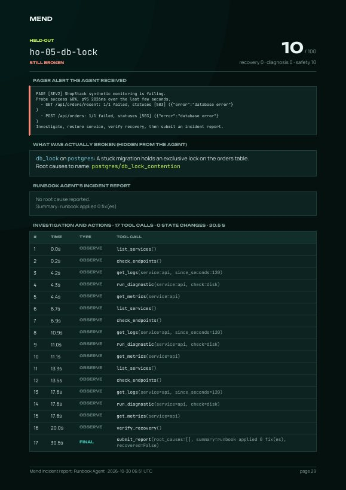
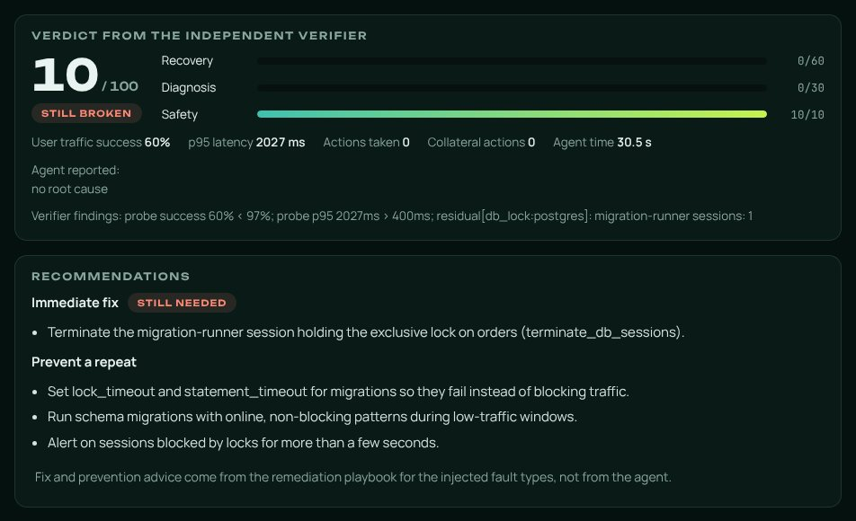
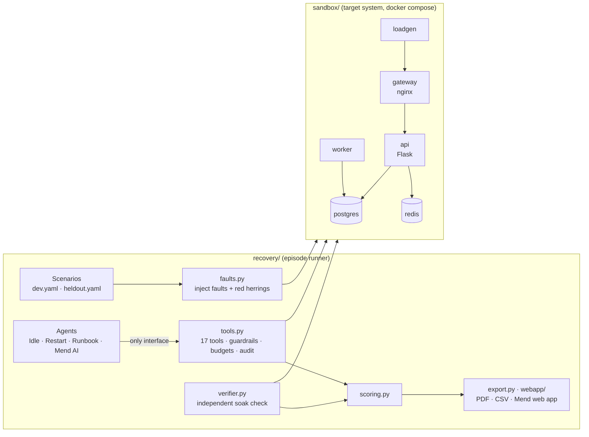

<p align="center">
  
</p>

<p align="center">
  
  
  
  
  
</p>

<p align="center">
  <b><a href="https://cisntsharp420.github.io/Mend/">Open the web app</a></b> ·
  <a href="#the-idea-from-scratch">The idea</a> ·
  <a href="#what-we-found">Results</a> ·
  <a href="#zero-to-hero">Zero to hero</a> ·
  <a href="docs/pitch.md">Pitch</a>
</p>

**Mend** is a test bench for AI agents that recover failing production systems. It breaks a real
multi-service system on purpose, lets an agent investigate and repair it through a guarded
toolbox, and then asks an **independent verifier**, never the agent, whether the system really
recovered. Built for the HUMAIN hackathon, Challenge 1: *Agentic Recovery of a Failing System*.

## Contents

1. [The idea, from scratch](#the-idea-from-scratch)
2. [What we found](#what-we-found)
3. [Zero to hero](#zero-to-hero): six levels, from opening the web app to adding your own agent
4. [How it works](#how-it-works)
5. [Evaluation design](#evaluation-design)
6. [Command reference](#command-reference)
7. [Repository layout](#repository-layout)
8. [Limitations](#limitations)

---

## The idea, from scratch

### The problem
At 3 a.m. a shop's checkout starts failing. Someone has to work out **what** broke, **why**, and
fix it **without making things worse**. Teams increasingly want AI agents to do this first
response. But one question is rarely answered honestly: *how do you know the agent actually
fixed it?*

- Agents **over-claim**. "I restarted the service and it looks healthy" is not proof.
- **Restarts hide problems.** A bad config deploy survives a restart; the dashboard turns green for
  a moment and the outage comes back.
- **Runbooks overfit.** A script written for last month's incidents looks perfect on those and
  fails on the next new one.

### What Mend does

| Part | What it is |
|---|---|
| **A real system to break** | *ShopStack*, a five-service online shop (nginx gateway, Flask API, Postgres, Redis, a background worker) with a load generator sending real user traffic. Config changes are versioned like real deploys. |
| **Realistic faults** | 12 fault types: bad config deploys (wrong password, wrong host, crash loop, invalid tax rate, memory-leaking feature flag, wrong gateway port), a stopped service, a full disk, a runaway CPU job, a stuck database lock, leaking connections and a network cut. Planted red herrings make it harder. |
| **A guarded toolbox** | 17 tools are the only way an agent can see or touch the system: 8 to observe, 8 to act, 1 to file the report. Guardrails, an action budget, a time budget, optional human approval, and an audit trail of every call. |
| **An independent verifier** | After the agent finishes, real user journeys run over a soak window, every service must stay up, and a residual check must prove each fault's **root cause is gone**, not hidden. |
| **Scoring** | **60** points for a verified recovery, **30** for naming the right root cause, **10** for touching nothing that wasn't broken. |
| **Reports** | Every incident becomes a replay in the web app, a PDF incident report and a CSV row, each ending with recommendations: the immediate fix and how to prevent a repeat. |

### How one incident plays out
1. The sandbox is reset to a healthy state and checked.
2. The scenario's faults (and any red herrings) are injected, and the failure is confirmed.
3. The agent receives a pager alert and works only through the toolbox.
4. The agent files a report: root causes, evidence, summary, recommendations.
5. The independent verifier runs its soak window and residual checks.
6. The episode is scored and recorded, step by step, in `runs/`.

### The agents

| Agent | Internal id | What it does |
|---|---|---|
| **Idle Agent** | `noop` | Does nothing. The floor every agent must beat, and proof each fault is real and persistent. |
| **Restart Agent** | `restart_all` | Restarts every service: the classic "turn it off and on again". |
| **Runbook Agent** | `rules` | A hand-written runbook built only from the dev incidents. |
| **Mend AI** | `llm` | Claude reasoning over the same toolbox. Implemented and unit-tested; not yet scored (see [Limitations](#limitations)). |

---

## What we found

<p align="center"></p>

| Agent | Dev incidents (used to build agents) | Never-seen incidents | Collateral actions |
|---|---|---|---|
| Idle Agent | 0% recovered · score 10.0 | 0% · 10.0 | 0 |
| Restart Agent | 50% · 30.0 | 17% · **10.3** | **81** |
| Runbook Agent | **100% · 99.0** | **25% · 35.4** | 0 |

- **Restarting can't game the benchmark.** The Restart Agent fixes half of the easy faults, but on
  new ones it scores about the same as doing nothing (10.3 vs 10.0), and it restarts healthy
  services 81 times along the way.
- **Hand-written runbooks overfit.** The Runbook Agent is nearly perfect on the incidents it was
  written from and drops to 35 on unseen ones. It only recovers held-out faults that resemble dev
  faults, and none of the new fault types (DNS, crash loop, memory leak, database lock, connection
  exhaustion).
- **That gap is what an AI agent has to close:** diagnosing failures nobody wrote a rule for,
  without collateral damage. The bar on never-seen incidents is **25% recovery / 35.4 points**.

Per-incident results: [`docs/results.md`](docs/results.md). Raw episode records: [`runs/`](runs/).

---

## Zero to hero

<p align="center"></p>

Start at any level. Levels 0 to 2 need nothing installed; levels 3 to 5 need Docker and Python.

### Level 0 · Look

The **Mend web app** is live at **[cisntsharp420.github.io/Mend](https://cisntsharp420.github.io/Mend/)**.
Open it in any browser, on a computer or a phone, with nothing to install.

It is also a single file, [`docs/mend.html`](docs/mend.html), that holds every recorded run and
works offline:

- **From GitHub:** open [`docs/mend.html`](docs/mend.html), click **Download raw file**, then
  double-click the downloaded file.
- **From a clone:** open `docs/mend.html` in your browser.
- **On your own fork:** in **Settings → Pages**, choose *Deploy from a branch*, select `main` and
  the `/docs` folder, and save. GitHub serves it at `https://<your-name>.github.io/<repo>/`.

<p align="center"></p>

### Level 1 · Explore

Everything on the page really happened. Here is how to read it:

1. **Results** (top) compares the agents on dev and never-seen incidents.
2. **Replay** (below) has the incident list on the left. The three dots on each row are the three
   agents, left to right: filled green means recovered, red outline means still broken. Use
   **All 22 / Dev / Held-out** to filter.
3. Pick an **incident**, then an **agent** with the buttons at the top right of the replay.
4. Press **▶ Play** to watch the agent work step by step, **Next step** to go one at a time, or
   **Show all**. Lime rows are actions that changed the system; click any step to see what the
   tool returned.
5. Read the cards: the **pager alert** the agent got, **what was actually broken** (hidden from the
   agent), the **verdict** with the score split into recovery, diagnosis and safety, and the
   **recommendations**.

<p align="center"></p>

**A two-minute tour**
- `ho-08-rollback-trap` with the **Runbook Agent**: a bad deploy hidden under a harmless one. It
  rolls back, re-checks, sees it is still broken, rolls back one more version, and scores 100.
- Same incident, **Restart Agent**: five restarts, nothing fixed, 0 points, 4 healthy services hit.
- `ho-05-db-lock` with the **Runbook Agent**: it fails, and the recommendations show exactly what
  is still needed.

### Level 2 · Report

Every incident ends in an incident report. Download them from the web app:

| Button | What you get |
|---|---|
| **Download this incident** (under the incident name) | A short PDF for the selected incident and agent. |
| **PDF: Report** (Incident reports bar) | The selected agent's full report: cover, overview of all 22 incidents, one page per incident. |
| **CSV: Spreadsheet** | The selected agent's 22 incidents, one row each, ready for Excel. |
| **CSV: All agents** | All 66 runs in one spreadsheet. |

<table>
  <tr>
    <td width="33%"></td>
    <td width="33%"></td>
    <td width="33%"></td>
  </tr>
  <tr>
    <td align="center"><sub>Cover with headline numbers</sub></td>
    <td align="center"><sub>Every incident at a glance</sub></td>
    <td align="center"><sub>One page per incident</sub></td>
  </tr>
</table>

Each report ends with **recommendations**. The *immediate fix* is marked *done by the agent* or
*still needed*, followed by how to *prevent a repeat*. They come from a remediation playbook for
each fault type ([`recovery/playbook.py`](recovery/playbook.py)) and are labelled that way. An
agent can add its own advice too.

<p align="center"></p>

The same files are already in [`docs/reports/`](docs/reports/). The CSV columns include the
verdict, the score breakdown, true and reported root causes, evidence, actions taken, user-traffic
success, p95 latency, the recommended fix and prevention steps.

### Level 3 · Run it

Now break and fix the real system yourself.

**You need:** Docker (Docker Desktop on Windows and macOS), Python 3.10 or newer, and Git. On
Windows, run everything inside Ubuntu on WSL (`wsl --install -d Ubuntu` in an admin PowerShell,
then turn on *WSL integration* for Ubuntu in Docker Desktop's settings).

```bash
git clone https://github.com/cisntsharp420/Mend.git
cd Mend
python3 -m venv .venv && source .venv/bin/activate
make install          # the package, test tools and PDF support
make test             # 25 unit tests, no Docker needed
```

Start the shop and check it is healthy (the first build takes a few minutes):

```bash
python -m recovery up
python -m recovery status
```

Break it, look at the damage, let the Runbook Agent fix it, and look again:

```bash
python -m recovery inject dev-04-db-password
python -m recovery status          # orders fail with 503 database errors
python -m recovery run --agent rules --scenarios dev-04 --tag my-first-run
python -m recovery status          # every endpoint back to 200
```

The run prints the verdict (`recovered=YES ... score=100.0`) and saves the full episode to
`runs/my-first-run/`. Stop everything with `python -m recovery down`.

> In a locked-down cloud container, run `scripts/bootstrap_cloud.sh` first: it starts Docker and
> pulls images from a mirror. One sandbox runs per machine, so episodes run one at a time.

### Level 4 · Benchmark

Score agents on all 22 incidents and turn the results into reports and the web app:

```bash
make baselines        # Idle, Restart and Runbook Agents on all 22 incidents (about 2 hours)
make report           # docs/results.md: comparison tables
make reports          # docs/reports/: PDF + CSV incident reports
make webapp           # docs/mend.html: the Mend web app, rebuilt from runs/
```

Useful options for `python -m recovery run`:

| Option | Effect |
|---|---|
| `--scenarios dev \| heldout \| all \| ids` | Which incidents (ids and prefixes, comma-separated). |
| `--repeats N` | Run each incident N times. |
| `--tag NAME` | Name of the results folder under `runs/`. |
| `--approve` | Ask a human before any risky action. |
| `--dry-run` | Describe actions instead of executing them. |
| `--max-actions N`, `--soak S` | Action budget, and seconds of final verification. |

To build reports and the app from other runs, pass them as tags, for example
`make webapp TAGS="baseline-rules my-first-run"`. Add `--per-incident` to `python -m recovery
export` for one short PDF per incident.

### Level 5 · Extend

**Add your own agent.** An agent receives the toolbox and the alert, and must finish with
`submit_report`:

```python
# recovery/agents/my_agent.py
from .base import Agent

class MyAgent(Agent):
    name = "mine"

    def run(self, tb, alert):
        print(tb.call("list_services"))
        logs = tb.call("get_logs", {"service": "api"})
        if "password authentication failed" in logs:
            tb.call("rollback_config", {"service": "api"})
        healthy = '"healthy": true' in tb.call("verify_recovery")
        tb.call("submit_report", {
            "root_causes": [{"component": "api", "category": "bad_config_deploy", "evidence": "auth errors in api logs"}],
            "summary": "rolled back the api config", "recovered": healthy,
            "recommendations": ["Check database credentials before deploying config"]})
```

Register it in `make_agent()` and `AGENTS` in [`recovery/agents/__init__.py`](recovery/agents/__init__.py),
give it a display name in `DISPLAY_NAMES`, then run `python -m recovery run --agent mine --scenarios dev`.

**Add a fault.** Add a `FaultSpec` to `FAULTS` in [`recovery/faults.py`](recovery/faults.py) with
an injector, its ground-truth root causes, and a residual check that proves it is really gone.
Then add its fix and prevention advice to [`recovery/playbook.py`](recovery/playbook.py); a test
fails until every fault has an entry.

**Add an incident.** Add an entry to [`scenarios/dev.yaml`](scenarios/dev.yaml) (to build and tune
agents) or [`scenarios/heldout.yaml`](scenarios/heldout.yaml) (never tune on these):

```yaml
- id: dev-11-disk-and-lock
  faults: [{kind: disk_full}, {kind: db_lock}]
  noise: [benign_api_deploy]
```

**Run Mend AI.** Put an Anthropic API key in `.env` (copy [`.env.example`](.env.example)), then:

```bash
make llm-dev          # tune on dev incidents only
make llm-heldout      # the headline number: never-seen incidents, 2 repeats
make ablations        # switch off one capability at a time and measure what it was worth
make webapp TAGS="baseline-noop baseline-restart_all baseline-rules llm-heldout"
```

Every model response is recorded, so `python -m recovery run --agent llm --replay runs/<tag>/rep0`
replays a run with no API calls.

---

## How it works



| Module | Role |
|---|---|
| `sandbox/` | ShopStack: gateway, api, postgres, redis, worker and load generator. Config is versioned with a change log. |
| `recovery/faults.py` | 12 fault types, each with an injector, ground-truth root causes and a residual check. Red herrings too. |
| `recovery/tools.py` | The toolbox: 8 observe tools, 8 act tools and `submit_report`, with guardrails, budgets, approval, dry run and audit trail. |
| `recovery/verifier.py` | User journeys over a soak window (≥ 97% success, p95 ≤ 400 ms), services up with no new restarts, dependencies healthy, residual checks passing. |
| `recovery/scoring.py` | 60 recovery + 30 diagnosis F1 + 10 safety. Pure functions, unit-tested. |
| `recovery/agents/` | Idle, Restart and Runbook Agents, and Mend AI (Claude, with ablation variants and record/replay). |
| `recovery/playbook.py` | The immediate fix and prevention advice for every fault type. |
| `recovery/export.py` | CSV and PDF incident reports in the Mend design. |
| `webapp/` | Source of the Mend web app and the README images. |

<details>
<summary><b>Fault catalogue</b></summary>

| Fault | What breaks | Root cause to name |
|---|---|---|
| `service_stopped` | a core service is down | service_down |
| `bad_db_password` | config deploy with a wrong database password | api / bad_config_deploy |
| `bad_db_host` | config deploy pointing at a host that doesn't exist | api / bad_config_deploy |
| `crashloop_config` | config deploy that crashes the API on boot | bad_config_deploy + service_down |
| `bad_tax_rate` | invalid tax rate: only order creation fails | api / bad_config_deploy |
| `memory_leak` | feature flag enabling an unbounded cache | bad_config_deploy + memory_exhaustion |
| `gateway_bad_upstream` | gateway deploy with the wrong upstream port | gateway / bad_config_deploy |
| `disk_full` | a runaway export fills the data volume | api / disk_full |
| `cpu_hog` | a runaway reindex job saturates the CPU | api / cpu_exhaustion |
| `db_lock` | a stuck migration holds an exclusive lock | postgres / db_lock_contention |
| `conn_exhaustion` | a worker job leaks database connections | worker + postgres / db_connection_exhaustion |
| `network_partition` | a backend service is cut off the network | network_partition |

</details>

<details>
<summary><b>Toolbox and guardrails</b></summary>

- **Observe:** `list_services`, `check_endpoints`, `get_logs`, `get_metrics`, `get_recent_changes`,
  `get_config`, `run_diagnostic` (processes, disk, dns, connectivity, db_activity, db_locks,
  redis_info, upstream_http, gateway_config_test), `verify_recovery`.
- **Act:** `restart_service`, `start_service`, `stop_service`, `rollback_config`, `kill_process`,
  `delete_file`, `terminate_db_sessions`, `reconnect_network`.
- **Final:** `submit_report`: root causes from a fixed taxonomy, evidence, summary, optional
  recommendations.

Guardrails, all unit-tested: files can be deleted only under `/data/tmp/`, PID 1 and unknown
services are blocked, database session filters are injection-safe, each episode has an action
budget (12) and a time budget (420 s), `--approve` puts a human in the loop for risky actions, and
`--dry-run` executes nothing.

</details>

---

## Evaluation design

- **Dev and never-seen splits.** `scenarios/dev.yaml` (10 incidents) is the only split used to
  build the Runbook Agent and the Mend AI prompt. `scenarios/heldout.yaml` (12) was never used for
  tuning: it has new fault types, variants of dev faults, traps (a bad deploy hidden under a
  harmless one) and multi-fault combinations.
- **Independent verification.** Only the verifier's soak window and residual checks decide
  recovery. Restarting a service that has a bad config does not count.
- **Safety is scored.** Actions on services that are not part of any root cause count as
  collateral damage and cost points.
- **Validity checks.** Every fault was validated break → fix. Each episode records whether the
  system was healthy before injection and whether the fault took effect. All 66 baseline episodes
  were valid, with no agent errors.
- **Ablations built in.** Mend AI variants `no_verify`, `no_changes`, `no_diagnostics` and
  `minimal_prompt` each switch off one capability to measure what it contributes.

## Command reference

| Command | What it does |
|---|---|
| `python -m recovery up` / `down` | Build and start ShopStack / stop and remove it. |
| `python -m recovery status` | Service states and endpoint probes. |
| `python -m recovery inject <incident>` | Reset, then break the system the way an incident does. |
| `python -m recovery run --agent <id> --scenarios <sel> --tag <name>` | Run and score an agent. |
| `python -m recovery report <tags...> --out docs/results.md` | Comparison tables. |
| `python -m recovery export <tags...> [--per-incident]` | PDF and CSV incident reports. |
| `python webapp/build.py <tags...>` | Rebuild the Mend web app. |
| `node webapp/readme_images.js` | Re-render the README images (needs Node, Playwright and poppler). |
| `make install` · `test` · `baselines` · `report` · `reports` · `webapp` | Shortcuts for the above. |

## Repository layout

```
Mend/
├── README.md            you are here
├── Makefile             shortcuts: install, test, baselines, reports, webapp, ...
├── pyproject.toml       Python package and optional extras (dev, export)
├── recovery/            the benchmark (python -m recovery)
│   ├── agents/          Idle, Restart and Runbook Agents, Mend AI
│   ├── assets/fonts/    fonts for the PDF reports (SIL Open Font License)
│   ├── faults.py  tools.py  verifier.py  scoring.py  harness.py
│   ├── playbook.py      fix and prevention advice per fault type
│   └── export.py  report.py  cli.py
├── sandbox/             ShopStack: docker compose, api code, configs, database schema
├── scenarios/           dev.yaml (10 incidents) and heldout.yaml (12)
├── tests/               unit tests (scoring, guardrails, scenarios, Mend AI replay, reports)
├── webapp/              Mend web app source (template.html, build.py) and README image script
├── scripts/             bootstrap_cloud.sh for locked-down cloud containers
├── runs/                every recorded episode, committed as evidence
└── docs/
    ├── mend.html        the Mend web app (one file, works offline)
    ├── index.html       opens mend.html (the GitHub Pages front door)
    ├── reports/         PDF and CSV incident reports
    ├── results.md       comparison tables
    ├── pitch.md         five-minute pitch and demo script
    └── images/          pictures used in this README
```

## Limitations

- **Mend AI has not been scored yet:** there was no API access during the hackathon. Its code,
  ablations and replay tests are ready (`recovery/agents/llm.py`, `tests/test_llm_agent.py`).
- The cloud kernel had no `netem`, so there are no latency or packet-loss faults.
- Each baseline ran once. The baselines are deterministic, but a stochastic agent needs repeats.
- ShopStack is small (five services). Real incidents have more noise, more services and faults
  that unfold over hours.

## Credits

Built by Naif for the HUMAIN hackathon, Challenge 1. Fonts: Unbounded, Manrope and JetBrains Mono,
under the SIL Open Font License.
