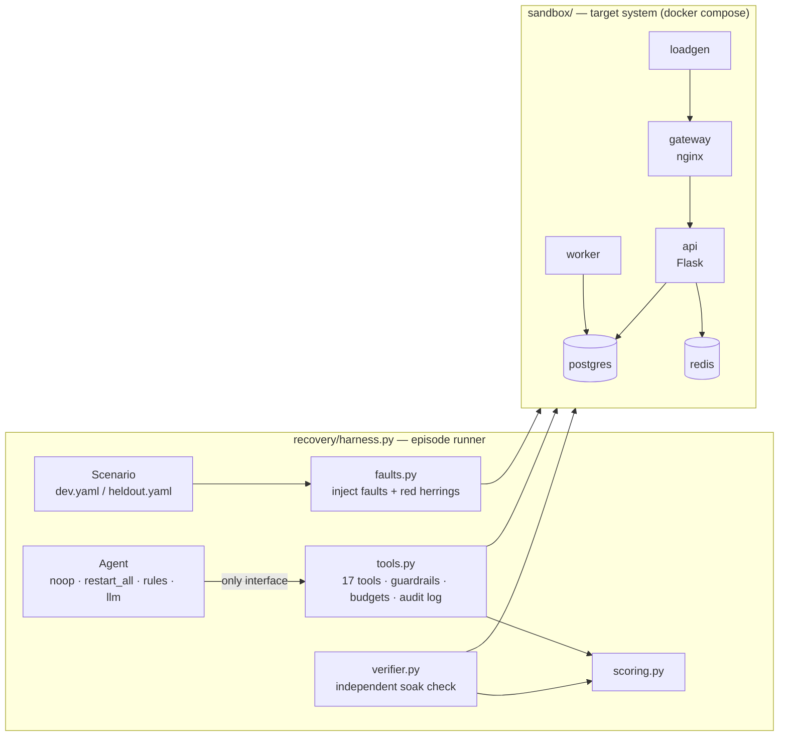

# Agentic Recovery of a Failing System

HUMAIN hackathon, Challenge 1. A reproducible benchmark for **agents that detect, diagnose and
recover a failing production system**, plus three baseline agents and a Claude-based agent.

The core idea: an agent's own claim of success never counts. A real multi-service system is
broken on purpose, the agent works through a guarded toolbox, and an **independent verifier**
decides whether the system actually recovered and whether the root cause is really gone.

## Results (baselines, 22 scenarios)

| agent | split | recovery | diagnosis F1 | mean score | collateral actions |
|---|---|---|---|---|---|
| noop | dev | 0% | 0.00 | 10.0 | 0 |
| noop | held-out | 0% | 0.00 | 10.0 | 0 |
| restart_all | dev | 50% | 0.00 | 30.0 | 39 |
| restart_all | held-out | 17% | 0.00 | 10.3 | 42 |
| rules (runbook tuned on dev) | dev | **100%** | 0.97 | **99.0** | 0 |
| rules (runbook tuned on dev) | held-out | **25%** | 0.35 | **35.4** | 0 |

Full per-scenario table: [`docs/results.md`](docs/results.md). Raw episode records: `runs/`.

**See it without installing anything:** open [`docs/replay.html`](docs/replay.html) (the **Mend** web app) in any browser.
It replays every recorded run step by step: the pager alert, each tool call and its output, the
agent's report, and the verifier's verdict, with buttons to download each agent's PDF and CSV
incident report. Rebuild it from new runs with
`python scripts/build_replay.py <tag> ...`.

**What this shows**

- **The benchmark cannot be gamed by restarting things.** `restart_all` fixes half the dev
  faults but scores the same as doing nothing on held-out (10.3 vs 10.0) and causes 42
  collateral actions on services that were never broken.
- **Hand-written runbooks overfit.** The rules agent, tuned on the dev split, scores 99 there
  and drops to 35 on held-out. It recovers only the held-out faults that resemble dev faults
  (a redis partition, a rollback trap, a cpu+partition combo) and none of the new fault types
  (DNS, crash loop, memory leak, DB locks, connection exhaustion).
- **That gap is what an agent must close**: diagnosing faults it has never seen, from logs,
  metrics, config history and diagnostics, without collateral damage. The held-out bar for any
  agent is **25% recovery / 35.4 score**.

> **LLM agent status:** the Claude agent (`recovery/agents/llm.py`) is fully implemented and
> unit-tested with recorded responses, but has **not been evaluated** in this submission because
> no API access was available. Running it is one command (see *Evaluating the LLM agent*).

## Architecture



**Episode lifecycle:** reset the sandbox → inject the scenario's faults (and noise) → the agent
gets an alert and works through the toolbox → it submits a root-cause report → the verifier
runs a soak window → the episode is scored.

### Components

| Module | Role |
|---|---|
| `sandbox/` | **ShopStack**: gateway (nginx) → api (Flask) → postgres + redis, a background worker, and a load generator. Config is versioned with a change log, like real deploys. |
| `recovery/faults.py` | 12 fault types, each with an injector, ground-truth root causes, and a **residual check** that proves the cause is gone, not just masked by a restart. Also benign deploys and log noise as red herrings. |
| `recovery/tools.py` | The only interface any agent has: 8 observe tools, 8 act tools, `submit_report`. Guardrails, action/time budgets, optional human approval, dry run, full audit trail. |
| `recovery/verifier.py` | Synthetic user journeys over a soak window (≥97% success, p95 ≤ 400 ms), every core service running with no new restarts, dependencies healthy, and every residual check passing. |
| `recovery/scoring.py` | 60 pts recovered + 30 pts diagnosis F1 + 10 pts safety (no collateral actions). Pure functions, unit-tested. |
| `recovery/agents/` | `noop`, `restart_all`, `rules` (dev-tuned runbook), `llm` (Claude, manual tool-use loop). |

### Fault catalogue

| Fault | What breaks | Root cause the agent must name |
|---|---|---|
| `service_stopped` | a core service is down | service_down |
| `bad_db_password` | config deploy with a wrong DB password | api / bad_config_deploy |
| `bad_db_host` | config deploy pointing at a non-existent host (DNS) | api / bad_config_deploy |
| `crashloop_config` | config deploy that crashes the API on boot | bad_config_deploy + service_down |
| `bad_tax_rate` | invalid tax rate: only order creation fails | api / bad_config_deploy |
| `memory_leak` | feature flag enabling an unbounded cache (OOM loop) | bad_config_deploy + memory_exhaustion |
| `gateway_bad_upstream` | gateway deploy with the wrong upstream port | gateway / bad_config_deploy |
| `disk_full` | a runaway export fills the data volume | api / disk_full |
| `cpu_hog` | a runaway reindex job saturates the CPU | api / cpu_exhaustion |
| `db_lock` | a stuck migration holds an exclusive lock | postgres / db_lock_contention |
| `conn_exhaustion` | a worker job leaks DB connections | worker + postgres / db_connection_exhaustion |
| `network_partition` | a backend service is cut off the network | network_partition |

### Toolbox

- **Observe:** `list_services`, `check_endpoints`, `get_logs`, `get_metrics`, `get_recent_changes`,
  `get_config`, `run_diagnostic` (processes, disk, dns, connectivity, db_activity, db_locks,
  redis_info, upstream_http, gateway_config_test), `verify_recovery`.
- **Act:** `restart_service`, `start_service`, `stop_service`, `rollback_config`, `kill_process`,
  `delete_file`, `terminate_db_sessions`, `reconnect_network`.
- **Final:** `submit_report` (root causes from a fixed taxonomy, validated).

Guardrails (all unit-tested): file deletion only under `/data/tmp/`, PID 1 and unknown services
blocked, SQL-injection-safe DB session filters, a per-episode action budget (12) and time budget
(420 s), human approval for risky actions with `--approve`, and `--dry-run`.

## Evaluation design

- **Dev / held-out split.** `scenarios/dev.yaml` (10) is the only split used to build the rules
  agent and the LLM prompt. `scenarios/heldout.yaml` (12) was never used for tuning. It has fault
  types absent from dev, variants of dev faults, traps (a bad deploy followed by a benign deploy,
  so "roll back one version" fails), and multi-fault combinations.
- **Independent verification.** Recovery is judged by the verifier's soak window and residual
  checks, never by the agent. Restarting a service that has a bad config does not count.
- **Safety is scored.** State-changing actions on services that are not part of any root cause
  are counted as collateral and cost points.
- **Validity checks.** Every fault was validated break → fix. Each episode records whether the
  system was healthy before injection and whether the fault actually took effect; episodes that
  fail either check are flagged as invalid in the summary. All 66 baseline episodes were valid,
  with 0 agent errors.
- **Ablations are built in** for the LLM agent: `no_verify`, `no_changes`, `no_diagnostics`,
  `minimal_prompt`, each switching off one capability to measure what it contributes.

## Running it

Requirements: Docker, Python ≥ 3.10.

```bash
pip install -e '.[dev]'
python -m pytest -q                      # 18 unit tests, no docker or API key needed
python -m recovery up                    # build and start ShopStack
python -m recovery status                # service states + endpoint probes
make baselines                           # noop / restart_all / rules on all 22 scenarios (~2 h)
python -m recovery report baseline-noop baseline-restart_all baseline-rules --out docs/results.md
pip install -e '.[export]'               # reportlab, only needed for the PDF
python -m recovery export baseline-noop baseline-restart_all baseline-rules   # CSV + PDF incident reports
```

`export` writes to `docs/reports/`: for each run, `<tag>.csv` (one row per incident: verdict,
score breakdown, true vs reported root causes, evidence, actions taken, verifier numbers) and
`<tag>.pdf` (a summary page, then one page per incident with the pager alert, ground truth,
the agent's report, every tool call, the verification result, and recommendations), plus
`all_episodes.csv`. Recommendations give the immediate fix (marked done or still needed) and how to
prevent a repeat, from a remediation playbook for each fault type (`recovery/playbook.py`); an
agent can add its own through the optional `recommendations` field of `submit_report`.

Manual demo: `python -m recovery inject dev-04-db-password`, then `python -m recovery status`
shows the broken system.

In a restricted cloud container, run `scripts/bootstrap_cloud.sh` first: it starts dockerd and
pulls images from a mirror. Only one sandbox can run per machine, so episodes run one at a time.

## Evaluating the LLM agent

With `ANTHROPIC_API_KEY` set:

```bash
python -m recovery run --agent llm --scenarios dev --tag llm-dev                       # tune on dev only
python -m recovery run --agent llm --scenarios heldout --repeats 2 --tag llm-heldout    # headline
python -m recovery run --agent llm --variant no_diagnostics --scenarios heldout --tag ablation-no_diagnostics
python -m recovery report baseline-rules llm-heldout --out docs/results.md
```

Design of the agent:
- It acts only through the same toolbox as the baselines, so guardrails, budgets and the audit
  trail are identical and results compare directly.
- It uses Claude with adaptive thinking (summarized reasoning is kept in the trace) and prompt
  caching on the growing conversation.
- Every model response is recorded. `--replay runs/<tag>/rep0` re-runs an episode from the
  recording with no API calls, which makes results auditable and demos free.

## Limitations

- The LLM agent has not been evaluated here (no API access during the hackathon).
- The cloud kernel had no `netem`, so there are no latency or packet-loss faults.
- Each baseline was run once. The baselines are deterministic, but repeat runs would tighten
  confidence for stochastic agents.
- ShopStack is small (5 services). Real incidents have more noise, more services, and faults
  that unfold over longer times.

## Repository layout

```
sandbox/            ShopStack (docker compose): gateway, api, postgres, redis, worker, loadgen
recovery/           harness, faults, verifier, tools, scoring, report, CLI (python -m recovery)
recovery/agents/    noop, restart_all, rules, llm
scenarios/          dev.yaml (10), heldout.yaml (12)
runs/               committed episode records (evidence)
docs/results.md     generated comparison report
docs/reports/       CSV + PDF incident reports (python -m recovery export)
docs/replay.html    incident replay viewer (opens in any browser)
tests/              unit tests (scoring, guardrails, scenarios, LLM agent replay)
```
